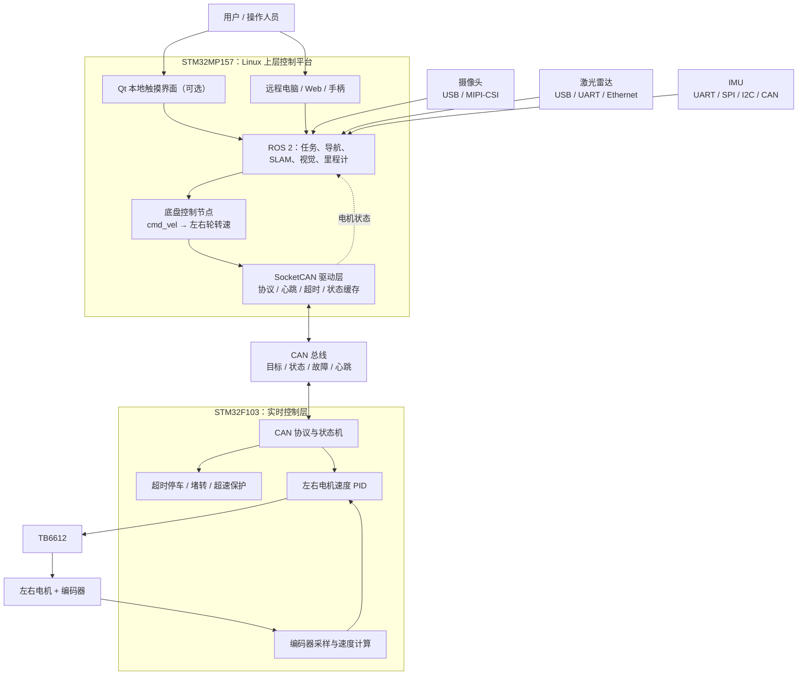

# STM32MP157 + STM32F103 电机控制与机器人扩展架构

## 1. 当前基础与目标

当前系统已经具备：

- STM32F103 控制 TB6612 驱动电机；
- 编码器反馈电机速度和位置；
- STM32F103 与 STM32MP157 已通过 CAN/SocketCAN 通信；
- STM32MP157 运行 Linux，可继续加入 ROS 2、Qt、摄像头、雷达和 IMU。

系统可以逐步发展为双轮差速机器人，实现闭环控制、里程计、遥控、建图、定位、避障和自主导航。

## 2. 总体架构图



## 3. 系统分层与职责

### 3.1 STM32F103：实时控制层

STM32F103 负责实时性和安全性要求较高的任务：

- 编码器采样和速度计算；
- 速度 PID，必要时增加位置环；
- PWM 和方向输出；
- CAN 命令解析与状态上报；
- 通信超时自动停车；
- 堵转、超速和编码器异常保护。

建议周期：

- 编码器采样和速度 PID：1～10 ms；
- 状态上报：20～100 ms；
- CAN 命令超时：200～500 ms，具体根据车速和安全要求调整。

Linux、ROS 2 或 Qt 异常退出时，F103 仍应独立进入安全状态。

### 3.2 TB6612：功率驱动层

TB6612 接收 F103 输出的 PWM 和方向信号，为电机提供驱动能力。它不负责 PID、通信和运动规划。

### 3.3 CAN：控制器通信层

CAN 在 MP157 和 F103 之间传输：

- 目标速度或目标位置；
- 使能、停止和清故障命令；
- 实际速度和编码器位置；
- PWM 与运行状态；
- 故障信息和节点心跳。

### 3.4 STM32MP157 + Linux：上层控制平台

MP157 不只是简单的上位机，它可以承担：

1. SocketCAN 协议编解码和节点管理；
2. 将机器人线速度、角速度换算为左右轮转速；
3. 里程计、传感器融合、SLAM、导航和视觉算法；
4. 网络通信、日志、远程调试和系统管理；
5. Qt、Web 或远程控制界面。

建议在 Linux 中封装统一接口：

```text
motor_enable(node_id)
motor_stop(node_id)
motor_set_velocity(node_id, velocity)
motor_get_state(node_id)
motor_clear_fault(node_id)
```

Qt 和 ROS 2 节点不应分别重复拼装原始 CAN 字节。

## 4. 当前系统可以实现的能力

- 单电机或双电机闭环调速；
- 正转、反转和平滑启停；
- 编码器位置和速度反馈；
- 双轮差速底盘手动控制；
- Linux 端状态监控；
- CAN 心跳和掉线检测；
- 通信中断自动停车；
- 堵转、超速等故障上报；
- 多电机节点管理。

当前首先需要稳定的链路：

```text
Linux 命令行程序
    ↓ 目标速度
SocketCAN
    ↓
STM32F103 速度 PID
    ↓
TB6612 + 电机
    ↓
编码器反馈和 CAN 状态上报
    ↓
Linux 实时监控
```

## 5. CAN 协议建议

| 方向 | 消息 | 主要内容 |
| --- | --- | --- |
| MP157 → F103 | 电机控制 | 模式、使能、目标速度或位置 |
| MP157 → F103 | 心跳 | Linux 主控在线状态 |
| MP157 → F103 | 参数设置 | PID 参数、状态上报周期 |
| F103 → MP157 | 电机状态 | 实际速度、编码器位置、PWM |
| F103 → MP157 | 故障状态 | 堵转、超速、通信超时 |
| F103 → MP157 | 心跳 | 电机节点在线状态 |

CAN ID 示例：

```text
0x100 + node_id：控制命令
0x180 + node_id：速度和位置状态
0x200 + node_id：PWM 和运行状态
0x280 + node_id：故障信息
0x700 + node_id：心跳
```

8 字节控制帧示例：

```text
Byte 0：控制模式（停止 / 速度 / 位置）
Byte 1：控制标志（使能 / 清故障）
Byte 2～5：目标值 int32，小端序
Byte 6：命令序号
Byte 7：协议版本或保留字段
```

协议应明确单位、倍率、字节序、有符号范围、节点 ID、版本、超时行为和故障码。第一版中，命令序号、心跳和超时保护通常比额外设计复杂 CRC 更重要。

## 6. ROS 2 的作用

ROS 2 不直接产生 PWM，也不替代 F103 上的实时 PID。它负责把底盘、传感器、算法和界面组织成完整系统：

```text
ROS 2：机器人想做什么
    ↓
Linux：计算各执行机构目标
    ↓
CAN：传输目标和状态
    ↓
STM32F103：固定周期实时控制
    ↓
TB6612：驱动电机
```

建议 ROS 2 接口：

- 订阅 `/cmd_vel`：目标线速度和角速度；
- 发布 `/odom`：轮式或融合里程计；
- 发布 `/joint_states`：左右轮关节状态；
- 发布 `/motor/status` 和 `/motor/fault`；
- 发布 `odom → base_link` 等 TF；
- 提供电机使能、停车和清故障服务。

初期先实现简单的 ROS 2 底盘节点，不必立即接入完整的 `ros2_control`。

## 7. Qt 的作用

Qt 是可选界面，不是电机控制、SocketCAN 或 ROS 2 的必需组件。它适合显示电机状态、故障、实时曲线、摄像头和地图，也可提供启停、急停、参数配置和模式切换。

```text
Qt 界面
    ↓ ROS 2 Topic / Service 或本地进程通信
底盘控制与电机管理服务
    ↓ SocketCAN
STM32F103
```

没有本地 LCD 或触摸屏时，可以不使用 Qt，改用 RViz、命令行、Web 页面或手柄。

## 8. 摄像头接入方式

摄像头通常直接连接 MP157：

```text
USB 或 MIPI-CSI 摄像头
    ↓
Linux 视频驱动 / V4L2
    ↓
ROS 2 摄像头节点
    ↓
/camera/image_raw
    ↓
视觉识别 / 跟踪 / 视觉避障
```

可用于视频显示、二维码识别、目标检测、车道线识别和视觉跟踪。MP157 算力有限，大型模型可能需要降低分辨率和帧率、使用轻量模型，或增加 NPU/GPU 计算设备。

## 9. 激光雷达接入方式

```text
二维激光雷达
    ↓ USB / UART / Ethernet
ROS 2 雷达驱动
    ↓
/scan
    ↓
SLAM / 定位 / 避障 / Nav2
```

雷达不直接控制电机。导航模块根据环境数据生成 `/cmd_vel`，底盘节点再换算左右轮目标速度并通过 CAN 下发。

## 10. IMU 接入方式

IMU 可以直接连接 MP157，也可以由 F103 采集后通过 CAN 上报。它与编码器融合后，可以改善角度和位置估计，降低轮胎打滑造成的累计误差：

```text
编码器里程计 ─┐
               ├─→ 状态估计 / 数据融合 → 更可靠的 /odom
IMU ───────────┘
```

## 11. 最终系统闭环

```text
摄像头 / 雷达 / IMU / 编码器
              ↓
       感知、定位与建图
              ↓
         路径规划与避障
              ↓
             cmd_vel
              ↓
     左右轮目标速度计算
              ↓
           SocketCAN
              ↓
     STM32F103 实时 PID
              ↓
      TB6612 + 左右电机
              ↓
          机器人运动
              ↓
       传感器重新观测
```

最终可以具备遥控、差速运动、融合里程计、SLAM 建图、地图定位、避障、路径规划、自主导航、视觉识别和 Qt 本地监控能力。

## 12. 推荐实施顺序

1. 完成编码器采样、速度计算和速度 PID；
2. 加入平滑启停、通信超时、堵转和超速保护；
3. 定义 CAN 控制、状态、故障和心跳帧；
4. 使用 `candump` 和 `cansend` 验证协议；
5. 编写 Linux SocketCAN 电机管理程序；
6. 测试断线、F103/MP157 重启和长时间运行；
7. 编写 ROS 2 底盘节点并接收 `/cmd_vel`；
8. 发布 `/odom`、`/joint_states` 和电机状态；
9. 加入 IMU，完成编码器与 IMU 融合；
10. 加入二维雷达，完成 SLAM、定位和 Nav2；
11. 根据需要加入摄像头和视觉算法；
12. 有本地触摸屏需求时，再开发 Qt。

## 13. 当前最重要的下一步

暂时不要同时引入 Qt、ROS 2、摄像头和雷达。先稳定以下链路：

```text
MP157 设置目标速度
    ↓
SocketCAN 发送控制帧
    ↓
F103 接收并执行速度 PID
    ↓
电机与编码器形成闭环
    ↓
F103 上报速度、位置和故障
    ↓
MP157 显示并检查运行状态
```

这条链路稳定后，再把 Linux 电机管理程序封装为 ROS 2 节点。之后加入 Qt、雷达、摄像头和导航时，底层控制无需推倒重写。
